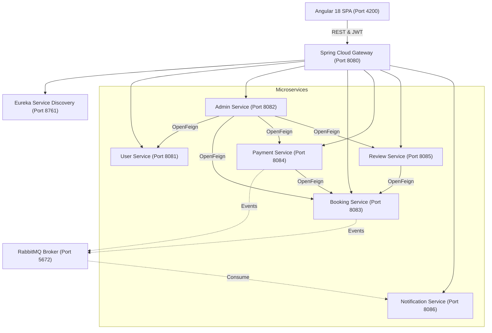

# 🚗✨ On-Demand Car Wash Platform (ODC)

A full-stack, production-ready distributed microservices platform for booking, dispatching, and managing doorstep car cleaning services. Built from scratch with **Spring Boot 3.3.4**, **Spring Cloud 2023.0.3**, **Java 21**, **RabbitMQ**, **Razorpay Test Integration**, and an **Angular 18 Single Page Application**.

---

## 🏗️ Architecture Overview

The platform is designed around a microservices architecture with a reactive API Gateway, Eureka Service Discovery, decentralized JWT authentication, RabbitMQ topic messaging, and an Angular 18 client.



---

## 🔌 Port Mapping & Endpoints

| Component | Port | Description | Swagger / Health |
|---|---|---|---|
| **Eureka Discovery Server** | `8761` | Service Registry | [http://localhost:8761](http://localhost:8761) |
| **API Gateway** | `8080` | Unified Entry Point & CORS | `/actuator/health` |
| **User Service** | `8081` | Auth, JWT, User Roles | [Swagger UI](http://localhost:8081/swagger-ui/index.html) |
| **Admin Service** | `8082` | KPI Dashboard, Moderation | [Swagger UI](http://localhost:8082/swagger-ui/index.html) |
| **Booking Service** | `8083` | Package Catalog, Wash Lifecycle | [Swagger UI](http://localhost:8083/swagger-ui/index.html) |
| **Payment Service** | `8084` | Razorpay Order & Signatures | [Swagger UI](http://localhost:8084/swagger-ui/index.html) |
| **Review Service** | `8085` | Ratings & Testimonials | [Swagger UI](http://localhost:8085/swagger-ui/index.html) |
| **Notification Service** | `8086` | Real-time In-App Notifications | [Swagger UI](http://localhost:8086/swagger-ui/index.html) |
| **Angular 18 Frontend** | `4200` | Single Page Application | [http://localhost:4200](http://localhost:4200) |

---

## 👥 Pre-Seeded Accounts

The database seeder automatically initializes the following test accounts:

| Role | Email | Password | Privileges |
|---|---|---|---|
| **Super Admin (GOD)** | `god@carwash.com` | `GodAdmin@2026!` | Immutable root administrator (cannot be blocked, deleted, or demoted) |
| **Administrator** | `admin@carwash.com` | `Admin@123` | Operational metrics, assign washers, moderate users |
| **Washer** | `washer@carwash.com` | `Washer@123` | View assigned jobs, update wash progress (Start / Complete) |
| **Customer** | `customer@carwash.com` | `Customer@123` | Schedule washes, online Razorpay checkout, submit reviews |

> 💡 **Quick Login:** The frontend login screen includes one-click buttons to instantly autofill credentials for each role!

---

## 🛠️ Prerequisites & Technology Stack

- **Java Development Kit (JDK)**: Java 21 LTS
- **Apache Maven**: 3.9+
- **Node.js**: v20+ / v22+
- **npm**: 10+
- **Database**: Defaults to zero-config in-memory **H2 Database** for immediate local execution. Optionally configurable for **MySQL 8.0** or **PostgreSQL** via environment variables.

---

## 🚀 How to Run the Platform

### 1. Build Backend Services & Run All Tests
From the root directory:
```bash
mvn clean test
```
All 8 microservices compile and execute 34 unit and integration tests across auth, booking state transitions, Razorpay signature verification, and admin audit logging.

### 2. Start Microservices in Order
Run each service in a separate terminal:

```bash
# 1. Start Eureka Discovery Server (Port 8761)
cd eureka-server
mvn spring-boot:run

# 2. Start API Gateway (Port 8080)
cd api-gateway
mvn spring-boot:run

# 3. Start Core Services
cd OnDemandCarWash-user-service && mvn spring-boot:run
cd OnDemandCarWash-booking-service && mvn spring-boot:run
cd OnDemandCarWash-payment-service && mvn spring-boot:run
cd OnDemandCarWash-review-service && mvn spring-boot:run
cd OnDemandCarWash-notification-service && mvn spring-boot:run
cd adminservice && mvn spring-boot:run
```

### 3. Start the Angular 18 Frontend
In a new terminal:
```bash
cd Frontend/odc-frontend
npm start
```
Open **[http://localhost:4200](http://localhost:4200)** in your browser.

---

## 💳 Razorpay Test Mode Workflow

1. Customer selects a wash package (Express ₹399, Interior ₹799, Full Premium ₹1499, Ceramic Pro ₹2999) and places a booking.
2. In the Customer Dashboard, clicking **💳 Pay Now** calls `POST /api/payments/create-order` to generate a Razorpay order ID in paise (`₹ × 100`).
3. The official Razorpay Modal opens. In test mode, test cards/UPI can be used.
4. On success, the frontend dispatches `POST /api/payments/verify` with `razorpay_order_id`, `razorpay_payment_id`, and `razorpay_signature`.
5. Payment Service verifies the HMAC-SHA256 signature server-side, updates the booking to `PAID`, and dispatches a `PaymentCompletedEvent` to RabbitMQ.

---

## 🛡️ Security & Role Enforcement

- **Stateless JWT**: Tokens signed using HMAC-SHA256 with user ID, email, and role claims.
- **God Account Protection**: `god@carwash.com` is protected in Java business logic; any attempt by any admin to block, deactivate, or demote the God account returns a `400 Bad Request`.
- **RBAC**: Endpoints strictly protected via Spring Security `@PreAuthorize("hasRole('...')")`.
- **Frontend Guards**: Angular `authGuard` and `roleGuard` ensure users only access views matching their role.
